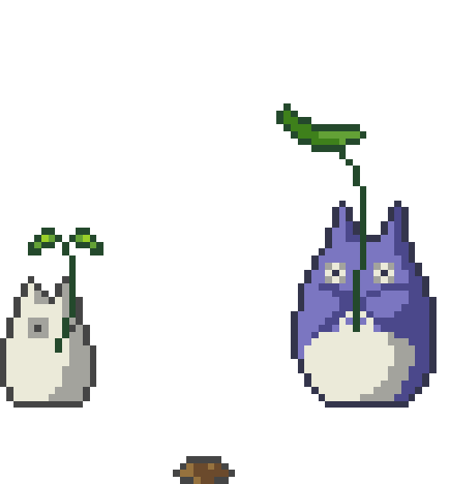
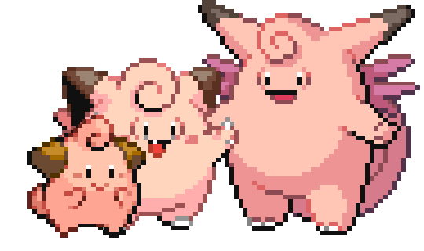
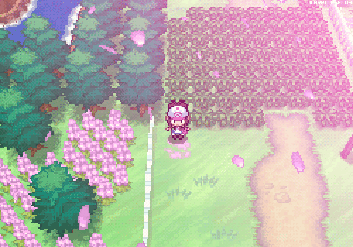

<table>
<tr>
<td width="50%" valign="middle">

### <strong>Olá! Meu nome é *Ana Carolina!*</strong>

Estou buscando aprender coisas novas e aprimorar meus conhecimentos por meio deste perfil!

Sempre gostei de fazer arte e junto com a minha curiosidade de aprender mais com a tecnologia
acabei tendo interesse na área de UX/UI!

<pre>
- 🎓 Estudante de Sistemas para Internet - <a href="https://www.fateclins.edu.br/web/">Fatec de Lins-SP.</a>
- 💻 Atualmente aprendendo Criação de HTMLs.
- 🚀 Interessada em FrontEnd.
- 📚 Sempre em busca de novos desafios.
</pre>

 

<!-- BOTÕES DE SEGUIR E ESTRELA -->

<!--IMAGEM -->

</td>

<td width="40%" align="center" valign="middle">

<!--IMAGEM -->

</td>
</tr>
</table>
 

---
### 🛠️ Ferramentas

 

---

 

<!--
**anacoliveira26/anacoliveira26** is a ✨ _special_ ✨ repository because its `README.md` (this file) appears on your GitHub profile.
-->
